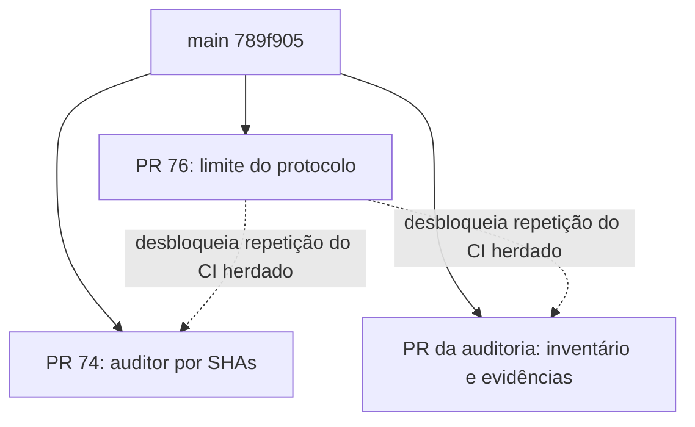

# Dependências de integração

Base verificada: main@789f9053f3e90a366a9f09542a0f7331b9d8348b. Nenhuma recuperação histórica funcional permanece sem equivalente demonstrado. DAG pendente é de correções descobertas e evidência documental.

PRs de código independentes usam main como base; as setas pontilhadas são ordem de validação, não imports/commits pendentes. Priorizar #76; após merge manual, reconciliar main sem force, repetir checks de #74 e relatórios. Nenhum ciclo de implementação identificado. Não retargetar automaticamente uma filha se sua mãe for rejeitada.

## Cadeia histórica já integrada

Persistência SQLite: SqlitePersistenceConfiguration.schemaMigration(DataSource, DatabasePaths) → SchemaMigration → EventStoreRepository append-only. AttemptSubmissionService importa o repositório e LearningEvidenceService (FSRS canônico). LearningShadowSnapshotService consome EventStoreRepository e LearningEvidenceService.MODEL_VERSION; LearningShadowService consome snapshot/AnalyticsPaths e nega capabilities recursivamente. AnalyticsProjectionService.exportPackageToDirectory captura getMaxRowid e gera manifesto do mesmo snapshot. Essa cadeia exige validação conjunta, já não há PR predecessora pendente.

Frontend QuestionViewer consome AttemptSubmission, ProspectivePreparation e prospectiveCaptureEnabled; preparação usa POST /api/v1/questions/{id}/predictions com contractVersion prospective-question-v1, e estado GET /api/v1/learning-lab/prospective-status. Ingestão: StagingDatabase → InventoryManager → BatchProcessor; publicação após curadoria. São dependências inspecionadas em imports/APIs/testes, não inferidas dos nomes das branches.

Ordem histórica especial: #59→#61 (base intermediária)→#65(main); #27/#28→#31(recuperação memória); #67→#68(substituição documental). #70 governança e #71 definições já integradas; não duplicar.

## Limites científicos

Java→exportação/manifesto→R é observacional. Experimentos não autorizam agendamento: can_apply=false/can_schedule=false. Fixtures não evidenciam aprendizagem pessoal. Não há proposta de promover modelo experimental nem modificar FSRS.
