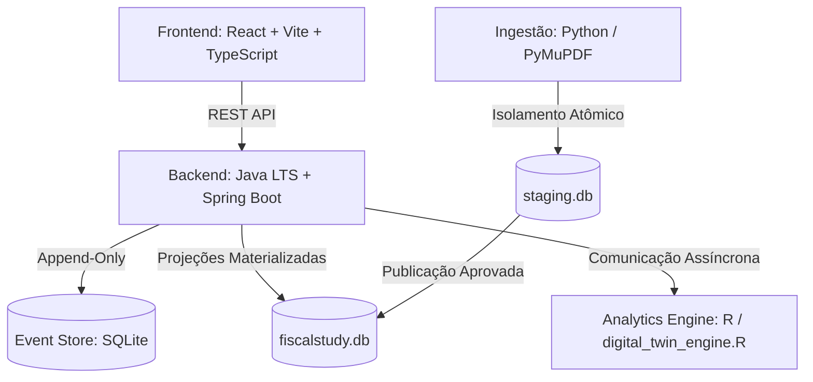

# Visão Sistêmica e Arquitetura

O FiscalStudy adota uma arquitetura modular, local-first e resiliente.

---

## 1. Componentes do Monorepo
- **`core-app/backend`**: Java LTS + Spring Boot. Controladores REST, regras de negócio determinísticas e integridade atômica com SQLite.
- **`core-app/frontend`**: React 18 + TypeScript + Vite. [[Tecnologia Calma]], sem dependências de UI genéricas radioativas.
- **`core-app/ingestion`**: Scripts e pipelines em Python para extração de provas e pareamento multi-cargo de gabaritos.
- **`analytics-engine`**: Motor psicométrico e estatístico em R para calibração longitudinal e meia-vida de retenção.

---

## 2. Princípios Imutáveis de Engenharia
1. **[[Event Store Imutável]]**: Resoluções de questões e anotações são eventos append-only.
2. **[[Isolamento Staging]]**: Nenhuma prova extraída é misturada com a base oficial de estudo antes de validação estrutural.
3. **Resiliência Total**: A indisponibilidade de R ou Python nunca impede o estudante de acessar suas sessões ou cadernos de questões.
