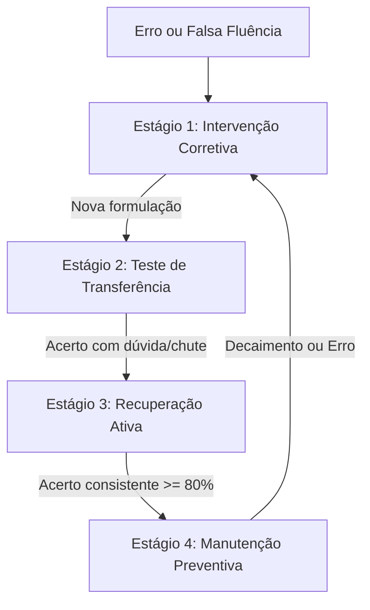

# Ciclo Adaptativo de Revisões em 4 Estágios

O `RevisionCalendarService` do FiscalStudy abandona agendamentos mecânicos baseados apenas em tempo (ex: 24h, 7d, 30d) e opera um ciclo cognitivo de 4 estágios dependente do desempenho real:

---

## Os 4 Estágios

### 1. Intervenção Corretiva
- **Gatilho**: Erros com alta confiança ([[Glossário do Domínio|Falsa Fluência]]) ou incompreensão conceitual (E1/E2).
- **Ação**: Prioridade máxima (0.80 a 0.95). Explicação conceitual imediata e diagnóstico do erro.

### 2. Teste de Transferência
- **Gatilho**: Erros em regras específicas (E3) ou pegadinhas da banca (E4).
- **Ação**: Apresenta a mesma regra cobrada sob outro contexto ou por outra banca examinadora para garantir que o aprendizado é robusto.

### 3. Recuperação Ativa
- **Gatilho**: Acertos com baixa confiança (1 ou 2) ou chutes educados.
- **Ação**: Sessão sem pistas para testar a retenção real antes de permitir o avanço.

### 4. Manutenção Preventiva
- **Gatilho**: Tópicos com acerto consistente (>= 80%) e confiança calibrada.
- **Ação**: Intervalos progressivamente dilatados para consolidar a memória permanente até a véspera da prova.
