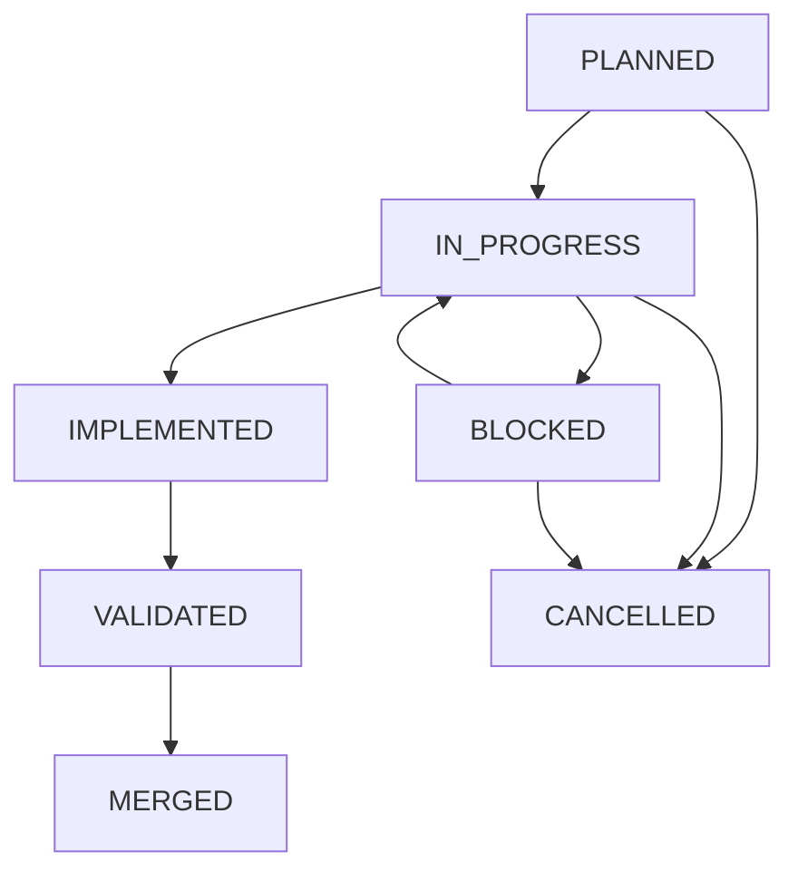

# Diário de Desenvolvimento — Protocolo de Continuidade de Tarefas

Este diretório armazena o registro de atividades e tarefas técnicas do FiscalStudy, viabilizando continuidade assíncrona entre diferentes sessões e agentes de IA sem a necessidade de reler o repositório completo.

---

## 1. Ciclo de Vida de uma Tarefa

Cada atividade relevante possui **um único arquivo principal** (ex: `TASK-2026-10-30-01.md`), atualizado de maneira incremental ao longo de seu ciclo:



### Estados Permitidos
- **`PLANNED`**: Tarefa mapeada, com objetivo, escopo e arquivos afetados previstos.
- **`IN_PROGRESS`**: Execução ativa por um agente, com branch definida.
- **`IMPLEMENTED`**: Código alterado e construído, aguardando execução de testes e evidências.
- **`VALIDATED`**: Código testado com suite automatizada e evidência registrada.
- **`BLOCKED`**: Tarefa impedida por dependência externa, falha de infraestrutura ou dúvida funcional.
- **`MERGED`**: Pull Request revisada e mesclada na branch principal com confirmação do GitHub.
- **`CANCELLED`**: Tarefa descartada ou substituída por outra abordagem.

---

## 2. Invariantes Rígidas de Governança

1. **Invariante de Validação**: É expressamente proibido transitar para o estado `VALIDATED` sem evidência empírica documentada (comando executado, número de testes e resultado).
2. **Invariante de Mesclagem**: É proibido transitar para `MERGED` sem confirmação formal da PR no GitHub.
3. **Sem Hashes Futuros**: Commits e hashes fictícios ou previstos não devem ser registrados; apenas commits já existentes na árvore Git.
4. **Nota Única e Incremental**: Não crie uma nova nota a cada alteração ou salvamento; atualize a nota existente.

---

## 3. Comandos CLI (Independentes de Modelo)

Os agentes manipulam tarefas através de `scripts/context.py task`:

```bash
# 1. Listar tarefas ativas
python scripts/context.py task list --status IN_PROGRESS

# 2. Exibir detalhes de uma tarefa
python scripts/context.py task show TASK-2026-10-30-01

# 3. Criar uma nova tarefa
python scripts/context.py task create TASK-2026-10-30-02 "Refatoração de API" "Objetivo da tarefa" --agent antigravity --branch feature/minha-branch --module backend

# 4. Atualizar incrementalmente
python scripts/context.py task update TASK-2026-10-30-02 \
  --status VALIDATED \
  --changes "Modificado endpoint X" \
  --tests "mvn test -Dtest=SuiteTest" \
  --evidence "Tests run: 5, Failures: 0, Errors: 0, Skipped: 0" \
  --next "Abrir Pull Request revisável"
```
